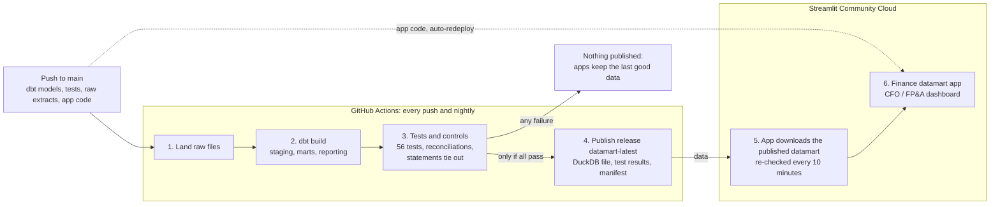

# University Finance Datamart: dbt + Snowflake

A finance datamart for **an international university in Vietnam**, built on a typical higher-education stack:

| Layer | Tool | Role |
|---|---|---|
| Sources | **SIS** (student information system: students, billing, payments) and **Workday Financials** (GL, cost centres, budget) | Systems of record |
| Warehouse | **Snowflake** on AWS (DuckDB for local runs and CI) | Central data platform |
| Transformation, tests, lineage | **dbt** | One governed transformation layer |
| Reporting | **Power BI**, Streamlit, SQL | Finance dashboards and self-service |

The design follows the same layered idea as
[AtliQ_Mart](https://github.com/KartikaySrivadtava/AtliQ_Mart) (raw → clean → business-ready), but in dbt's vocabulary:
`raw → staging → intermediate → marts`.

> **All data is synthetic** (`scripts/generate_source_data.py`, fixed seed). It does not describe any real university.
> Every name, fee, volume, balance and cost is invented.

## Layers

| dbt layer | Schema | Materialisation | What happens |
|---|---|---|---|
| raw | `RAW_SIS`, `RAW_WORKDAY` | tables (loaded by `COPY INTO`) | Extracts land as-is. **Every column is VARCHAR**, plus `_source_file` and `_loaded_at` |
| staging | `STAGING` | views | One model per source table: dedupe, trim, standardise codes, parse dates, cast money to `DECIMAL(18,0)` |
| intermediate | `INTERMEDIATE` | tables | Business logic: enrich invoices, quarantine test invoices, **revenue schedule** (billed → earned), invoice position at the snapshot |
| marts / finance | `FINANCE` | tables (facts incremental) | **Star schema for Power BI:** 6 dimensions, 5 facts, plus a One Big Table extract |
| marts / reporting | `REPORTING` | tables | Pre-built answers: KPIs, AR aging, collections, budget vs actual, school contribution |
| marts / statements | `STATEMENTS` | tables | Income statement (AASB group format and VAS B02-DN), balance sheet extract, ECL allowance |
| seeds | `REFERENCE` | tables | Finance-owned mappings: account → statement line, ECL provision matrix |
| snapshots | `SNAPSHOTS` | SCD Type 2 tables | History of program fees and cost-centre hierarchy |
| audit | `AUDIT` | table | `audit_data_quality` is a readable trail of every issue found and how it was handled |

The full lineage graph is in `docs/dbt_docs_lineage.html`. Open it in a browser and click the graph icon at the bottom right.

## Controls (`dbt build` runs 56 tests; all pass)

- **Integrity:** unique and not-null keys, foreign-key `relationships` (invoice → school/campus, journal line → cost centre), accepted values for status and payment channel.
- **Finance reconciliations** (`tests/`):
  - The revenue schedule ties to issued invoices (to the dong).
  - No invoice is overpaid after the bank-feed dedupe.
  - Every Workday journal line reaches the GL fact (no lines are lost to bad dates or joins).
  - The AR aging total ties to billed minus collected.
  - The AASB and VAS income statements give the same operating result.
  - Statement revenue equals earned tuition, and statement expenses equal GL actuals.
  - The flat extract (`obt_student_finance`) carries exactly the invoices and net tuition of the fact table.
- **Business-rule warnings:** `warn_invoice_above_fee_schedule` flags an invoice above its program fee without stopping the build.
- **Freshness:** `dbt source freshness` warns if an SIS or Workday extract is more than 2 days old.

If any test fails, `dbt build` stops, so bad numbers never reach Power BI.

## Reporting tables (snapshot `31 Oct 2026`, set with `--vars '{snapshot_date: 2026-10-31}'`)

| Table | Question |
|---|---|
| `rpt_finance_kpis` | Where do we stand at month-end? |
| `rpt_ar_aging` | Where is cash stuck? |
| `rpt_collections` | Are we collecting on time? |
| `rpt_budget_vs_actual` | Who is over or under budget? |
| `rpt_school_contribution` | What does each school contribute after its direct costs? |
| `rpt_income_statement_aasb` / `_vas` | What do the statutory-style statements look like in each format? |
| `rpt_balance_sheet_extract` | What are student receivables, the ECL allowance and contract liabilities? |

## What the demo data shows

| KPI | Value |
|---|---|
| Net tuition billed, 2026 YTD | 1,172 bn VND |
| Tuition earned, 2026 YTD | 980 bn VND |
| Deferred tuition revenue | 283 bn VND |
| Student AR outstanding | 165 bn VND (42% over 90 days) |
| DSO | 51 days |
| Opex vs budget, YTD | +0.7% |

1. **Hanoi has a collections problem.** On-time collection is 63% there, against about 79% at the other campuses, and Hanoi holds the largest over-180-day balance.
2. **Opex is on budget overall, but that hides two variances.** Marketing agent commissions are 16% over budget, offset by IT running 19% under after licences were consolidated.
3. **STEM is the lowest-margin degree school** (~42% contribution vs 60%+ for Business and Design). It has a ~20% scholarship rate and sessional staff costs above plan.
4. **Billed ≠ earned.** 283 bn is billed but not yet taught.
5. **The raw data needed cleaning.** It had 479 duplicate invoices, 281 replayed payments (without the fix, 276 invoices would look overpaid) and 158 journal dates in dd/MM/yyyy format. All of this is logged in `audit_data_quality`.

## dbt + Snowflake + AWS techniques

These techniques come from the [Airbnb end-to-end project (dbt + Snowflake + AWS)](https://github.com/anshlambagit/Airbnb_Snowflake_DBT_Data_Engineer_Project), with its [video walkthrough](https://www.youtube.com/watch?v=3SZSDKEZqoA), adapted for finance controls:

| Technique | Airbnb project | Here |
|---|---|---|
| Incremental models | bronze/silver loaded by `created_at` | `fct_student_payments` (45-day lookback for late bank-feed rows) and `fct_gl_actuals` (re-reads from the previous month for month-end adjustments); `unique_key` makes re-runs idempotent, and CI re-runs them to prove it |
| Snapshots (SCD Type 2) | hosts, listings, bookings | `snap_program_fees` (fee schedule history) and `snap_cost_centres` (re-orgs), using the `check` strategy because the sources have no reliable `updated_at`. `scripts/simulate_change.py` applies next month's extract, and CI asserts the history |
| One Big Table via a Jinja config list | `obt.sql` with hard-coded `AIRBNB.SILVER...` names | the `metadata_join` macro builds `obt_student_finance` through `ref()`, so lineage, CI and environments keep working |
| Reusable macros | `multiply`, `tag`, `trimmer` | `money`, `parse_date` (cross-database), `aging_bucket` (one rule shared by the aging report, ECL and the extract) |
| Source tests with `severity: warn` | booking amount check | fee-schedule check: flag, don't block month-end |
| Analyses with Jinja loops | `loop.sql`, `if_else.sql` | `analyses/variance_commentary_draft.sql`: the variances above 10% per account category, ready for commentary |
| S3 → Snowflake stage | `COPY INTO` with AWS keys in SQL | `snowflake/02_s3_external_stage.sql` uses a storage integration (IAM role, no keys in SQL), with an optional Snowpipe auto-ingest |
| Custom `generate_schema_name` | yes | yes |

## Financial statements: group format (AASB) and local format (VAS)

`models/marts/statements/` turns the same ledger into statutory-style statements. This is what a Vietnam entity of a foreign university group has to produce:

| Model | What it is |
|---|---|
| `fct_statement_lines` | One row per fiscal year × account. Both statement formats read from this single source |
| `rpt_income_statement_aasb` | Income statement in a typical Australian university annual-report line order (Fees and charges, Employee related expenses, Impairment of financial assets, Other expenses...). Lines with no Vietnam activity are kept at zero so the layout maps 1:1 to the group report |
| `rpt_income_statement_vas` | The same ledger in the Vietnamese B02-DN layout (revenue, revenue deductions, cost of services, selling, G&A) |
| `rpt_balance_sheet_extract` | Student receivables (gross), the ECL allowance and contract liabilities (tuition billed but not yet taught) at the prior year-end and at the snapshot |
| `int_ecl_allowance` | A simplified AASB 9 provision matrix applied to aged student balances |

Both mappings live in `seeds/account_statement_mapping.csv`, a Finance-owned file. The mapping and the ECL rates in `seeds/ecl_provision_matrix.csv` are **illustrative assumptions**.

## Data flow: from GitHub to Streamlit



| Step | Where | What happens |
|---|---|---|
| Build and test | `.github/workflows/ci.yml` | Lands the raw files, runs `dbt build`, the incremental re-run, the SCD2 check, source freshness and the three-statement tie-out |
| Publish | same workflow, last step | On `main` only, and only when every step passed: uploads `uni_finance.duckdb`, `build_results.json` and `manifest.json` (commit, run, time, tests passed) to the `datamart-latest` release |
| Load | `app_common.py` | Both apps download the published datamart and re-check the manifest every 10 minutes, so a new build reaches an open app without a restart |
| Show | sidebar of both apps | The build number, commit and time of the data on screen, linked back to the GitHub run |

A failed test stops the flow before publishing, so the apps never show untested numbers. If the release cannot be reached, the app builds the datamart itself with the same steps (`DATAMART_SOURCE=local` forces this).

## Live demo app (Streamlit)

`streamlit_app.py` reads the dbt-built DuckDB file. It has 9 pages:
- month-end headline
- financial performance (annual-report-style commentary generated by rules from the marts, with prior-year comparatives and a student statistical snapshot)
- tuition and scholarships
- receivables and collections
- budget vs actual
- school contribution (a waterfall)
- financial statements (AASB group format, VAS B02-DN and a balance sheet extract)
- data quality and controls (with live dbt test results)
- how it's built

On first start the app lands the raw files and runs `dbt build` itself, so every number on screen has passed every test.

```bash
pip install -r requirements.txt
streamlit run streamlit_app.py
```

To deploy on Streamlit Community Cloud: go to share.streamlit.io, choose **Create app**, pick this repo with branch `main` and file `streamlit_app.py`, then **Deploy**.

## CFO / FP&A dashboard (second app)

`fpa_dashboard.py` uses every mart in the datamart, presented in a CFO dashboard format: one month selector, YTD against budget and prior year, status flags, waterfalls and a one-line insight on every page.

| Page | What it answers |
|---|---|
| Executive summary | Income statement, balance sheet and cash flow on one screen |
| CFO brief | Status, key driver, risk and action for revenue, gross profit, EBITDA and net profit |
| YTD analysis | What moved each metric from prior year to this year, by school or by cost line |
| Income statement | Month, YTD and full year (actual + forecast) against prior year and budget |
| Tuition & scholarships | Gross fees to scholarships to net billing to earned revenue; by school, campus, level, residency, program |
| School contribution | Contribution and margin by school against budget and prior year, down to EBITDA |
| Cost centres vs budget | Variance by cost centre and by cost type |
| Receivables & collections | Aging, expected credit loss, DSO, collection rates by campus, payment channels |
| Balance sheet | Movement, composition and strength against the opening balance |
| Return on equity | DuPont: margin, asset turnover and leverage |
| Cash flow | Opening to closing cash and the indirect statement |
| Liquidity | Debt service coverage, months of cash, liquidity against borrowings |
| Data quality & controls | Tests, reconciliations, source issues handled, and which data each page uses |

Revenue, costs, the cost budget, billings and collections come from the dbt marts. Fixed assets, borrowings, tax and the revenue budget are illustrative assumptions kept in `fpa_model.py`, which CI checks: the balance sheet must balance and the cash flow must explain the movement in cash.

```bash
streamlit run fpa_dashboard.py
```

To deploy it, create a second app on Streamlit Community Cloud from the same repo with main file `fpa_dashboard.py`.

## AI with controls (Snowflake Cortex Code pattern)

This follows Snowflake's [Data Engineering with Cortex Code](https://www.snowflake.com/en/developers/guides/data-engineering-with-coco/) guide, adapted to finance:

| File | Purpose |
|---|---|
| `AGENTS.md` | Project rules any AI coding agent must follow: DECIMAL money, keep reversals, earned revenue, a reconciliation test for every new fact |
| `.cortex/plugins/uni-finance/skills/new-finance-model/SKILL.md` | The workflow for adding a model |
| `.cortex/plugins/uni-finance/hooks/validate-bash.sh` | A guard that blocks agents from running `--target snowflake`/prod or `--full-refresh`, and from editing raw SIS/Workday tables |
| `.cortex/plugins/uni-finance/agents/finance-dbt-review.md` | A review subagent that reports PASS/FAIL per finance rule |
| `.github/workflows/ci.yml` | Runs every model and test on DuckDB for each push and pull request, with no secrets needed |
| `.github/workflows/pr-review.yml` | An optional AI review comment on pull requests. It is skipped unless the Snowflake secrets are set |

The plugin layout follows the guide but has not yet been tested inside Cortex Code itself. The guard script is tested locally.

## Run it

**Locally, with no Snowflake account (DuckDB):**
```bash
pip install -r requirements.txt
python scripts/load_raw_local.py                 # lands raw_files/ into uni_finance.duckdb (all VARCHAR)
dbt build --profiles-dir . --target local        # 36 models, 2 seeds, 2 snapshots, 56 tests
python scripts/simulate_change.py && dbt snapshot --profiles-dir . --target local   # SCD2 demo
dbt docs generate --static --profiles-dir . --target local
```

**On Snowflake (a free trial works):**
1. Run `snowflake/01_setup_and_load.sql` in Snowsight. It creates the warehouse, database, roles, stage and raw tables. Upload the 8 CSVs to the stage when the script says so, then run the `COPY INTO` statements.
2. `pip install dbt-snowflake`, then set `SNOWFLAKE_ACCOUNT` and `SNOWFLAKE_USER` (and `SNOWFLAKE_AUTHENTICATOR` if you don't use SSO).
3. `dbt build --profiles-dir . --target snowflake`
4. Connect Power BI to it as described in `docs/power_bi_model.md`.

The same models run on both targets. The only engine-specific SQL is date parsing, which is handled by the `parse_date` macro in `macros/finance_helpers.sql`.

## Design choices a Finance reviewer will ask about

- **Why land raw data as VARCHAR?** Typing is a deliberate, tested step. It avoids silent coercion of account codes or day/month swaps.
- **Why DECIMAL and not FLOAT?** Sums of money must be exact.
- **Why keep negative GL lines?** They are accrual reversals. Only zero or negative *invoices* are quarantined (kept, not deleted).
- **Why earned revenue?** A period C invoice is billed in September but taught October to January. Spreading it over the teaching months matches revenue to the period it was taught in.
- **Why not allocate shared services?** The allocation key (EFTSL, headcount or floor space) is a Finance policy decision, so the model shows shared services as their own line.
- **Why a seed for the statement mapping?** Mapping the chart of accounts to AASB and VAS lines is a Finance decision. Keeping it in a versioned file, protected by tests, makes every change reviewable.

## Known simplifications

- The data has no 2024 invoices, so 2025 earned revenue is missing the January slice of period 2024C.
- Students are billed once per teaching period, so AR aging clusters in particular buckets by design.
- There is no FX, refunds, credit notes or write-offs yet.

## Next steps

- Replace the CSV landing with Workday and SIS integrations.
- Schedule `dbt build` after each month-end close (dbt Cloud or Airflow), passing `snapshot_date`.
- Add Snowflake row access policies so each Head of School sees only their own school.
- Publish the Power BI app to Finance.
